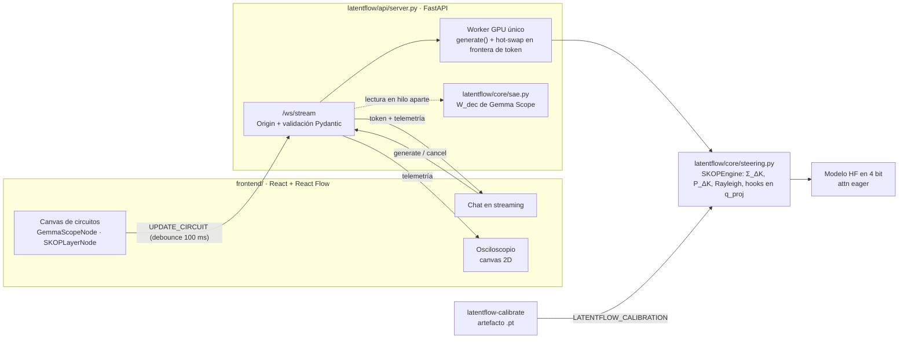
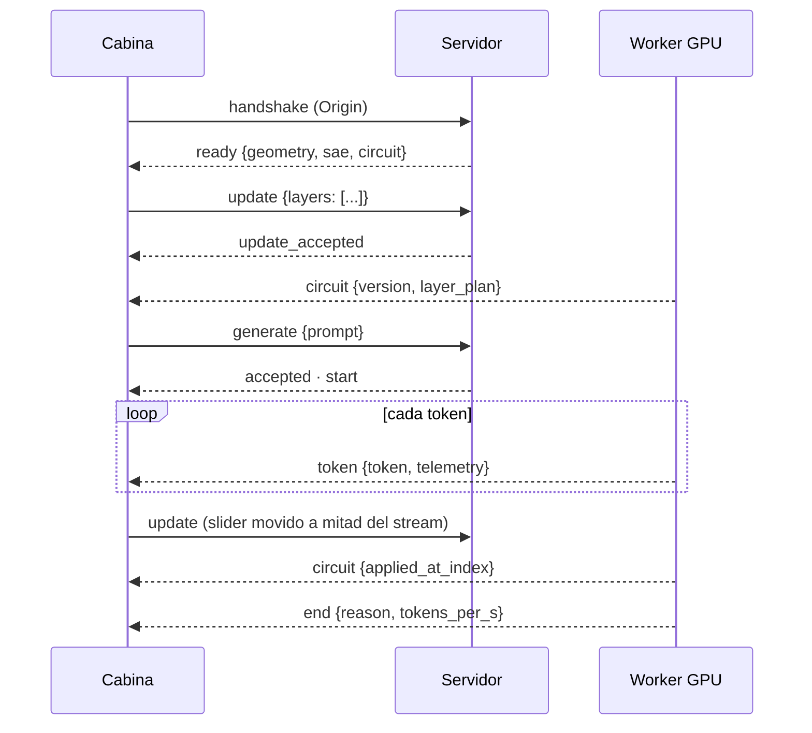

# BrainSteer · LatentFlow

[](https://github.com/ddaikodaiko/BrainSteer/actions/workflows/ci.yml)
[](LICENSE)


**IDE de steering de atención para LLMs locales.** BrainSteer intercepta las
queries de cada cabeza de atención de modelos como Gemma-2-2B-IT o Llama-3.1-8B
(cuantizados a 4 bit para una GPU de 8 GB). Les inyecta direcciones conceptuales
(vectores calibrados o features de Gemma Scope) y, con la proyección ortogonal
**SKOP**, protege el patrón de atención de las cabezas en las que el steering es
más arriesgado. Todo se pilota desde un canvas de nodos con chat en streaming y un
osciloscopio de riesgo en tiempo real.

> **Estado del proyecto.** El motor, el servidor y la cabina están cubiertos por
> el CI (pytest + Vitest + build) y se han probado de extremo a extremo contra el
> backend de desarrollo (modelo tiny de pesos aleatorios) en Chromium. **Falta la
> validación con pesos reales** de Gemma-2 y de los SAEs de Gemma Scope en GPU: la
> [Guía del piloto local](#guía-del-piloto-local) describe exactamente ese paso.

## Índice

- [Arquitectura](#arquitectura)
- [Puesta en marcha](#puesta-en-marcha)
- [Guía del piloto local](#guía-del-piloto-local) (Gemma-2 + Gemma Scope en tu GPU)
- [Fundamentos matemáticos](#fundamentos-matemáticos)
- [Contrato del WebSocket `/ws/stream`](#contrato-del-websocket-wsstream)
- [Configuración](#configuración)
- [Seguridad](#seguridad)
- [Tests y CI](#tests-y-ci)

## Arquitectura



| Módulo | Responsabilidad |
| --- | --- |
| [`latentflow/core/steering.py`](latentflow/core/steering.py) | Motor SKOP: calibración de `Σ_ΔK` (Focus/Tail), proyector `P_ΔK`, ranking de Rayleigh, inyección en `q_proj`, telemetría |
| [`latentflow/core/sae.py`](latentflow/core/sae.py) | Resolución sin red de IDs de Neuronpedia a `W_dec[f]` (Gemma Scope local, caché de Hugging Face, ficheros `.safetensors`/`.npz`/`.pt`) |
| [`latentflow/api/server.py`](latentflow/api/server.py) | Servidor FastAPI + WebSocket: streaming, hot-swap, plan por capa, protección de Origin |
| [`latentflow/tools/initializer.py`](latentflow/tools/initializer.py) | CLI `latentflow-calibrate`: genera el artefacto de calibración a partir de datasets locales |
| [`latentflow/tools/dev_backend.py`](latentflow/tools/dev_backend.py) | CLI `latentflow-dev`: el mismo servidor sobre un modelo tiny, sin GPU |
| [`frontend/`](frontend/README.md) | Cabina visual: canvas de nodos, chat, osciloscopio |

## Puesta en marcha

```bash
pip install -e ".[server,models,test]"
```

**Sin GPU** (desarrollo de la UI): el backend de desarrollo ejecuta el servidor real
sobre un Llama tiny de 26 capas con pesos aleatorios. El texto generado es ruido,
pero el protocolo, el streaming, el hot-swap y la telemetría son los de producción.
Cada Feature ID se simula con un vector determinista (sha256 del ID).

```bash
latentflow-dev                                  # ws://127.0.0.1:8000/ws/stream
cd frontend && npm ci && npm run dev            # http://127.0.0.1:5173
```

El ciclo de calibración también funciona offline:

```bash
latentflow-calibrate --dev --utility examples/calibration/utility.example.jsonl \
    --concept examples/calibration/concept.example.jsonl -o calib/dev_skop.pt
LATENTFLOW_CALIBRATION=calib/dev_skop.pt latentflow-dev
```

**Con GPU**: sigue la guía siguiente.

## Guía del piloto local

De cero a pilotar Gemma-2-2B-IT con features reales de Gemma Scope. Los comandos
son para Linux/macOS; en PowerShell, `export VAR=valor` se escribe `$env:VAR="valor"`.

### 0. Requisitos

- GPU NVIDIA con **≥ 8 GB de VRAM** y CUDA (la cuantización NF4 de bitsandbytes la necesita).
- Python ≥ 3.10 y Node 22.
- Disco: unos 5 GB para Gemma-2-2B-IT y unos 300 MB por cada SAE de Gemma Scope de ancho 16k.
- Una cuenta de Hugging Face con la licencia de Gemma aceptada en
  [google/gemma-2-2b-it](https://huggingface.co/google/gemma-2-2b-it).

### 1. Instalar

```bash
git clone https://github.com/ddaikodaiko/BrainSteer.git && cd BrainSteer
python -m venv .venv && source .venv/bin/activate
pip install -e ".[server,models,test]"
(cd frontend && npm ci)
```

### 2. Autenticarse en Hugging Face

```bash
hf auth login
```

> Con `huggingface_hub` reciente, la CLI se llama `hf`; el antiguo `huggingface-cli`
> ya no se instala.

### 3. Descargar los SAEs de Gemma Scope

Cada feature de Neuronpedia indica su SAE. Por ejemplo,
`gemma-2-2b/20-gemmascope-res-16k/12082` es la feature 12082 del SAE **residual**
de la **capa 20**, ancho **16k**. En Hugging Face, ese SAE está en el repo
`google/gemma-scope-2b-pt-res`, en la carpeta del L0 que Neuronpedia usa como
*canonical*: `layer_20/width_16k/average_l0_71`. Descarga sólo las capas que vayas
a usar:

```bash
hf download google/gemma-scope-2b-pt-res --include "layer_20/width_16k/average_l0_71/*"
```

El fichero queda en la caché de Hugging Face y el resolvedor lo encuentra ahí, sin
red. Cada capa tiene su propio L0 canonical; para saber qué descargar para otra
feature, pregúntale al resolvedor:

```bash
python -c "from latentflow.core.sae import FeatureRef; print(FeatureRef.parse('gemma-2-2b/6-gemmascope-res-16k/0').hf_location)"
# ('google/gemma-scope-2b-pt-res', 'layer_6/width_16k/average_l0_70')
```

La tabla completa (Gemma-2 2B, 9B y 27B; residual y MLP) está en
[`latentflow/core/gemma_scope_canonical.py`](latentflow/core/gemma_scope_canonical.py),
generada a partir del catálogo de SAELens. Si una feature no se encuentra, el error
incluye el comando `hf download` exacto.

- **Si prefieres una carpeta propia**, descarga con
  `--local-dir "$LATENTFLOW_SAE_DIR/gemma-scope-2b-pt-res"` y define
  `LATENTFLOW_SAE_DIR`. El resolvedor espera el árbol del repo:

  ```text
  $LATENTFLOW_SAE_DIR/
  └── gemma-scope-2b-pt-res/
      └── layer_20/
          └── width_16k/
              └── average_l0_71/
                  └── params.npz        # contiene W_dec (16384 × 2304)
  ```

- **Para SAEs de MLP**, el repo es `google/gemma-scope-2b-pt-mlp`.
- **Los SAEs de atención (`att`) no sirven:** su decoder no vive en el residual stream.

Comprueba la resolución antes de arrancar nada:

```bash
python -c "from latentflow.core.sae import GemmaScopeResolver as R; f = R().resolve('gemma-2-2b/20-gemmascope-res-16k/12082', 2304); print(f.source, tuple(f.vector.shape))"
# gemma-scope:/.../layer_20/width_16k/average_l0_71/params.npz (2304,)
```

### 4. Preparar los datos de calibración

`latentflow-calibrate` no descarga nada. Exporta un *utility set* genérico (para
Σ_ΔK) y escribe un *concept set* de pares `{"positive", "negative"}` (para `r_q`):

```bash
pip install datasets
python - <<'EOF'
from datasets import load_dataset
load_dataset("tatsu-lab/alpaca", split="train[:200]").to_json("data/alpaca.jsonl")
load_dataset("openai/gsm8k", "main", split="train[:200]").to_json("data/gsm8k.jsonl")
EOF
```

Para el concept set, entre 50 y 200 pares que aíslen el comportamiento a dirigir
(formato en [`examples/calibration/`](examples/calibration/README.md)). Para una
primera prueba sirve `examples/calibration/formal_informal.jsonl` (60 pares de
registro formal ↔ informal). Si sólo vas
a usar features de Gemma Scope, el concept set sigue siendo necesario: aporta el
`r_q` de respaldo de las capas sin features.

### 5. Calibrar

```bash
latentflow-calibrate --utility data/alpaca.jsonl --utility data/gsm8k.jsonl \
    --concept data/mi_concepto.jsonl -o calib/gemma2_skop.pt
```

Revisa el resumen que imprime:

- **`pasos (cabeza × query) con Focus y Tail`** debe ser > 0. Si es 0, los textos
  son demasiado cortos o `--tau-high` es tan alto que el Focus Set se lleva todas
  las keys; usa textos más largos o baja `--tau-high` (SKOP usa 0.8).
- **`rango medio de U_ΔK`** indica cuántas direcciones elimina P_ΔK (γ = 0.90).

Con `--layers 18-22` sólo se calibran esas capas (un índice fuera del modelo es un
error, no se reinterpreta). El servidor adopta las capas del artefacto: las anuncia
en `ready.layers` y responde `invalid_layer` a cualquier otra.

El artefacto es `latentflow.skop/v3` (Focus Set por masa, media por pasos y
$\Sigma_{\Delta K}$ por cabeza de query). Los de la versión anterior (`v2`) se
rechazan al cargar: hay que regenerarlos con `latentflow-calibrate`.

### 6. Arrancar el servidor

```bash
export LATENTFLOW_MODEL_ID=google/gemma-2-2b-it
export LATENTFLOW_CALIBRATION=calib/gemma2_skop.pt
latentflow-server
curl -s http://127.0.0.1:8000/health    # "calibrated": true
```

### 7. Abrir la cabina

```bash
cd frontend && npm run dev               # http://127.0.0.1:5173
```

La cabecera debe mostrar **SAE: Gemma Scope local**.

### 8. Primer circuito

1. En un nodo *Gemma Scope*, escribe `gemma-2-2b/20-gemmascope-res-16k/12082` y
   pulsa **Enter** (o sal del campo). Mientras escribes no se envía nada; **Esc**
   descarta el borrador. Busca más features en [Neuronpedia](https://www.neuronpedia.org/gemma-2-2b).
2. Conéctalo a un *inyector de capa* en la **capa 21**. Un SAE residual de la capa
   *L* describe el residual tras el bloque *L*, así que su entrada natural son las
   queries de *L + 1*.
3. El nodo debe pasar de `pendiente` a **`W_dec ✓`**.
4. Lanza un prompt, mueve el slider de α durante el stream y observa en el
   osciloscopio los marcadores de hot-swap y las trazas de las cabezas proyectadas.

### Solución de problemas

| Síntoma | Causa y solución |
| --- | --- |
| `feature_not_found` | No hay `params.npz` para ese SAE. El mensaje incluye las rutas buscadas y el comando `hf download` exacto (paso 3) |
| `hf download`: `Model 'google/gemma-scope-…-canonical' not found` | Ese repo no existe: *canonical* es el nombre de la release en SAELens. Usa `google/gemma-scope-2b-pt-res` (paso 3) |
| `feature_invalid … d_model` | El SAE es de otro modelo (p. ej. Gemma-2-9B) |
| Nodo en rojo: `error: att no soportado` | SAE de atención; usa una feature `res` o `mlp` |
| Error de calibración que menciona `eager` | El modelo se cargó con SDPA/Flash; `latentflow-calibrate` ya fuerza `eager`, no lo sobrescribas |
| `CUDA out of memory` al calibrar | `--batch-size 1` o `--max-length 128` |
| El WebSocket responde 403 | El frontend corre en un origen no permitido; ajusta `LATENTFLOW_ALLOWED_ORIGINS` |
| Vite: `Port 5173 is in use` | El puerto es fijo (`strictPort`) para casar con la lista de orígenes; libéralo |

> Gemma Scope se entrenó sobre `gemma-2-2b` (base). Usar sus features con `-it` es
> una práctica habitual, pero no una garantía de que transfieran igual.

## Fundamentos matemáticos

### SKOP en una página

El motor sigue el Algoritmo 1 de SKOP ([Luo, Espinosa Zarlenga y Jamnik,
arXiv:2605.06342](https://arxiv.org/abs/2605.06342)) con los hiperparámetros del
paper: $\tau_{\text{high}} = 0.8$, $\gamma = 0.9$ y el 20 % de las cabezas. Todo es
**por cabeza de query** (capa ℓ, cabeza *h*); con GQA, cada cabeza usa las keys de
su grupo KV.

**1. Geometría de keys (utility set, modelo base).** Para cada paso (query) *t*
con distribución de atención real $a_t$, el *Focus Set* es el conjunto mínimo de
keys que acumula al menos $\tau_{\text{high}}$ de la masa, y el *Tail Set* es el
resto de keys atendibles:

$$
\mathcal{F}_t = \operatorname*{arg\,min}_{S}\Big\{\, |S| \;:\; \textstyle\sum_{s \in S} a_{ts} \ge \tau_{\text{high}} \Big\}, \qquad
\mathcal{T}_t = \{\, s : a_{ts} > 0 \,\} \setminus \mathcal{F}_t .
$$

$\mathcal F_t$ se construye ordenando las keys por probabilidad descendente (los
empates, por posición) y añadiéndolas hasta cubrir la masa. El segundo momento
(sin centrar) promedia los pares de cada paso y da a todos los pasos el mismo peso:

$$
\Sigma_{\Delta K} \;=\; \mathbb{E}_{t}\; \mathbb{E}_{(i,j) \sim \mathcal{U}(\mathcal{F}_t \times \mathcal{T}_t)}\!\left[ (k_i - k_j)(k_i - k_j)^{\top} \right].
$$

Los pasos sin Tail (p. ej. la primera query, que sólo ve una key) no cuentan.

**2. Subespacio de riesgo.** Con $\Sigma_{\Delta K} = V \Lambda V^{\top}$ y los
autovalores en orden descendente, se retienen las $k$ primeras direcciones hasta
acumular una fracción $\gamma$ de la energía:

$$
k = \min \Big\{ k : \textstyle\sum_{i \le k} \lambda_i \,\big/\, \sum_i \lambda_i \;\ge\; \gamma \Big\}, \qquad
P_{\Delta K} = I - U_k U_k^{\top},
$$

de modo que $P^2 = P$ y $P^{\top} = P$ (los tests lo verifican en float64).

**3. Ranking de riesgo.** El cociente de Rayleigh mide la energía absoluta con la
que la dirección perturba el gap de score entre Focus y Tail, por unidad de norma:

$$
R_h(r) = \frac{r^{\top} \Sigma_{\Delta K}\, r}{\lVert r \rVert^2 + \varepsilon} \;\in\; \big[\lambda_{\min},\, \lambda_{\max}\big].
$$

Las cabezas por encima del percentil 80 global (todas las capas calibradas) son de
riesgo. `SKOPConfig(normalize_rayleigh=True)` usa en su lugar
$\hat\Sigma = \Sigma_{\Delta K} / (\operatorname{tr}\Sigma_{\Delta K} + \varepsilon)$, que acota
$R_h$ en $[0, 1]$ y lo hace comparable entre capas de escalas distintas. Es una
opción nuestra, desactivada por defecto.

**4. Inyección.**

$$
q' = \begin{cases} q + \alpha\, P_{\Delta K}\, r_q & \text{si } R_h(r_q) > \tau_R \text{ y la capa está en modo orthogonal} \\ q + \alpha\, r_q & \text{en otro caso} \end{cases}
$$

Como $q'^{\top} \Delta k = q^{\top} \Delta k + \alpha\, (P_{\Delta K} r_q)^{\top} \Delta k$
y $P_{\Delta K}$ anula el subespacio donde se concentra $\Delta k$, el steering
apenas altera la diferencia de score entre tokens Focus y Tail. Es decir, conserva
el patrón de atención del modelo base. $P_{\Delta K} r_q$ y $r_q$ se precalculan
en float64, así que en inferencia sólo queda una suma vectorial por capa.

> **RoPE.** Las keys de $\Sigma_{\Delta K}$ y el steering viven en el espacio previo
> a RoPE. En el score real, la perturbación de la query *t* frente a la key *i* es
> $\delta q^{\top} R_{i-t}\, k_i$, con $R_{i-t}$ la rotación relativa. La protección
> de $P_{\Delta K}$ es exacta sólo donde esa rotación es pequeña (las frecuencias
> bajas de RoPE) y aproximada en las altas. El paper no trata este punto; falta
> medir su efecto con pesos reales.

### La factorización exacta Kᵀ G K

Enumerar los pares es prohibitivo: por cada paso hay hasta $|\mathcal F_t|\,|\mathcal T_t|$
productos exteriores de coste $d^2$. Desarrollando el producto, para un paso:

$$
\sum_{i \in \mathcal{F}_t} \sum_{j \in \mathcal{T}_t} (k_i - k_j)(k_i - k_j)^{\top}
= |\mathcal{T}_t| \sum_{i \in \mathcal{F}_t} k_i k_i^{\top}
+ |\mathcal{F}_t| \sum_{j \in \mathcal{T}_t} k_j k_j^{\top}
- s^{F}_t \big(s^{T}_t\big)^{\top} - s^{T}_t \big(s^{F}_t\big)^{\top},
$$

con $s^{F}_t = \sum_{i \in \mathcal F_t} k_i$ y $s^{T}_t = \sum_{j \in \mathcal T_t} k_j$.
Con las máscaras binarias $M_F, M_T \in \{0,1\}^{T \times T}$ (fila = query,
columna = key), $n^F = M_F \mathbf{1}$, $n^T = M_T \mathbf{1}$ y el peso de cada
paso $c_t = 1 / (n^F_t\, n^T_t)$ (0 si alguno es vacío), la suma ponderada sobre
todos los pasos es una única forma cuadrática:

$$
\boxed{\; \sum_t c_t \sum_{i,j} (k_i - k_j)(k_i - k_j)^{\top} \;=\; K^{\top} G\, K \;}
\qquad
G = \operatorname{diag}(w) - C - C^{\top},\quad
w = M_F^{\top} \tfrac{1}{n^F} + M_T^{\top} \tfrac{1}{n^T},\quad
C = M_F^{\top} \operatorname{diag}(c)\, M_T ,
$$

donde $K \in \mathbb{R}^{T \times d}$ son las keys que usa la cabeza ($1/n$ se toma
elemento a elemento y sólo en los pasos con $c_t > 0$). Dividiendo por el número de
pasos con Focus y Tail no vacíos se obtiene $\Sigma_{\Delta K}$.

| | Enumeración de pares | Factorización $K^{\top} G K$ |
| --- | --- | --- |
| Coste por cabeza | $O(P\, d^2)$, con $P = \sum_t \lvert\mathcal F_t\rvert\lvert\mathcal T_t\rvert \le T^3/4$ → $O(T^3 d^2)$ | $O(T^3 + T^2 d + T d^2)$ |
| Memoria | $O(d^2)$ | $O(T^2)$ para $G$ |
| Forma | bucles con datos dependientes | productos matriciales densos (`einsum`) en el device |

Los términos son $C$ ($T^3$), $G K$ ($T^2 d$) y $K^{\top}(G K)$ ($T d^2$). Para
Gemma-2-2B ($d = 256$) y $T = 256$, el peor caso de la enumeración ronda las
$10^{11}$ operaciones por cabeza frente a unas $5 \cdot 10^{7}$ de la
factorización. Con Focus Sets pequeños, que es lo típico, $P$ es mucho menor y la
ventaja es más modesta, pero el coste de la factorización no depende de $P$ y se
ejecuta como álgebra densa. Cada capa se reduce en el device y sólo baja a la CPU
la matriz $d \times d$ en float64. La implementación
([`focus_tail_second_moment`](latentflow/core/steering.py)) se valida contra la
definición literal (Focus por masa, media por paso), con padding a izquierda y
derecha y GQA. La factorización es nuestra; el paper sólo define la esperanza.

### De una feature de SAE a una dirección de query

El decoder de una feature $f$ de un SAE residual, $W_{\text{dec}}[f] \in \mathbb{R}^{d_{\text{model}}}$
(2304 en Gemma-2-2B), vive en el residual stream, no en el espacio de queries
($8 \times 256$). El motor lo transporta por la misma ruta que recorre el residual
dentro del bloque, usando los módulos reales del modelo y sin disparar hooks:

$$
r_q^{(\ell)}(f) = W_Q^{(\ell)} \cdot \operatorname{RMSNorm}^{(\ell)}\!\big(W_{\text{dec}}[f]\big),
\qquad
r^{(\ell)} = \alpha \sum_f \alpha_f\, r_q^{(\ell)}(f).
$$

Es una **aproximación**: RMSNorm se evalúa en $v = W_{\text{dec}}[f]$ y no en el
residual $h$ de cada token. Su Jacobiano real,
$J(h)\, v = g \odot \big(v - h\, \tfrac{h^{\top} v}{\lVert h \rVert^2}\big) / \operatorname{rms}(h)$,
coincide en dirección sólo si $v \perp h$. En el modelo de desarrollo, la similitud
coseno con el cambio real de la query es ≈ 0.99 para una $v$ aleatoria, pero su
mediana baja a 0.87 o 0.72 (mínimo 0.54) cuando $v$ se alinea parcial o fuertemente
con el residual, que es justo el caso de una feature activa. La escala tampoco es la real: aquí la fija $|v|$; en el modelo,
$\operatorname{rms}(h)$. El vector resultante vive en el espacio previo a RoPE (ver
la nota de RoPE). El ranking de Rayleigh se recalcula con $r^{(\ell)}$, así que
$P_{\Delta K}$ se aplica sólo a las cabezas de alto riesgo *para esa feature*.

## Contrato del WebSocket `/ws/stream`

Mensajes JSON de texto. Todos los mensajes del cliente llevan `action`; todos los
del servidor, `type`. Las tablas reflejan
[`latentflow/api/server.py`](latentflow/api/server.py) y sus tipos están espejados
en [`frontend/src/lib/protocol.ts`](frontend/src/lib/protocol.ts).

### Handshake

El header `Origin` se valida **antes** de aceptar la conexión. Un origen fuera de
`LATENTFLOW_ALLOWED_ORIGINS` recibe **HTTP 403** y no se crea ninguna sesión. Al
conectar, el servidor envía `ready`.



### Cliente → servidor

Los campos desconocidos se rechazan (`invalid_message`).

| `action` | Campos | Efecto |
| --- | --- | --- |
| `generate` | `prompt` (str, ≥ 1)<br>`request_id?` (≤ 128)<br>`max_new_tokens` = 128 (1–4096)<br>`temperature` = 0 (0–5; 0 = greedy)<br>`top_p` = 1 (0–1]<br>`chat` = `true` (plantilla de chat)<br>`telemetry` = `"risky"` (`none` \| `summary` \| `risky` \| `all`) | Encola una generación; una activa por sesión |
| `update` | `alpha?`, `steering?`, `skop_filter?`, `gamma_energy?` (0–1], `risk_percentile?` [0–1], `layers?`, `reset_layers?` | **UPDATE_CIRCUIT**: hot-swap del circuito (ver abajo) |
| `cancel` | — | Detiene la generación activa de la sesión |
| `calibrate` | `utility`, `positive`, `negative` (listas de str) | Recalibra el motor en el servidor |
| `status` | — | Responde `status` |
| `ping` | — | Responde `pong` |

### `UPDATE_CIRCUIT` (`action: "update"`)

```json
{
  "action": "update",
  "steering": true,
  "layers": [
    {
      "layer": 21,
      "alpha": 1.0,
      "mode": "orthogonal",
      "features": [
        { "feature_id": "gemma-2-2b/20-gemmascope-res-16k/12082", "alpha": 2.5 },
        { "feature_id": null, "alpha": -1.0 }
      ]
    },
    { "layer": 6, "alpha": 0.5, "mode": "additive" }
  ]
}
```

- **Modo global** (sin `layers`): `alpha` y `skop_filter` afectan a todas las
  capas calibradas.
- **Plan por capa** (`layers`): sustituye el plan completo y sólo las capas
  listadas reciben steering. Cada capa admite:

  | Campo | Rango | Significado |
  | --- | --- | --- |
  | `layer` | ≥ 0, calibrada | Índice de capa |
  | `alpha` | −1000 a 1000 | Ganancia de la capa |
  | `mode` | `additive` \| `orthogonal` | Steering aditivo o proyección SKOP en las cabezas de riesgo |
  | `features` | hasta 64 | Dirección `alpha · Σ_f alpha_f · r_q(f)`; `feature_id: null` aporta el `r_q` calibrado. Sin `features`, la dirección es el `r_q` calibrado |

- **`reset_layers: true`** vuelve al modo global; es incompatible con `layers`.
- **`gamma_energy` y `risk_percentile`** reajustan los proyectores y el ranking.
- **Aplicación:** los Feature IDs se resuelven en un hilo aparte y el cambio se
  aplica en la siguiente frontera de token, sin cortar el stream. Las
  actualizaciones de una sesión se aplican en orden; si dos caen en la misma
  frontera, prevalece la más reciente.
- **Barrera con `generate`:** un `generate` espera a que terminen los `update` que
  la sesión envió antes que él, así que su prefill ya usa las features resueltas
  (mientras espera, `accepted` llega con `queued: true`). Un `update` posterior al
  `generate` se aplica como hot-swap durante el stream.
- **Respuestas:** `update_accepted` inmediato (con `features` resueltas y
  `deferred: true` si hay una generación en curso) y, al aplicarse, un evento
  `circuit` difundido a **todas** las sesiones, porque el circuito es global al
  proceso.

### Servidor → cliente

| `type` | Campos | Cuándo |
| --- | --- | --- |
| `ready` | `model`, `geometry`, `layers`, `hidden_size`, `sae`, `circuit` | Al conectar |
| `accepted` | `request_id`, `queued` | Generación encolada (`queued`: la GPU estaba ocupada o espera a un `update` anterior) |
| `start` | `request_id`, `prompt_tokens`, `circuit` | Empieza la generación |
| `token` | `request_id`, `index`, `token`, `token_id`, `circuit_version`, `telemetry` | Cada token (**STREAM_CHUNK**) |
| `end` | `request_id`, `reason` (`eos` \| `length` \| `cancelled` \| `stop` \| `error`), `num_tokens`, `text`, `elapsed_s`, `tokens_per_s` | Fin de la generación |
| `update_accepted` | `changes`, `deferred`, `features?` | `update` validado y encolado |
| `circuit` | `changes`, `applied_at_index`, `request_id`, `circuit` | Cambio aplicado; `applied_at_index` es el token tras el que se aplicó |
| `calibrated` | `num_pairs`, `num_utility`, `circuit` | Recalibración terminada |
| `status` | `circuit`, `busy`, `active_request_id`, `sessions` | Respuesta a `status` |
| `pong` | `server_time` | Respuesta a `ping` |
| `error` | `code`, `message`, `request_id?`, `action?`, `details?` | Ver tabla de errores |

`token` puede llegar vacío si el token completa un carácter UTF-8 multibyte: el
texto se emite con el token siguiente.

### Telemetría de riesgo (por token)

```json
{
  "type": "token",
  "request_id": "a1b2c3d4e5f6",
  "index": 17,
  "token": " la",
  "token_id": 1234,
  "circuit_version": 4,
  "telemetry": {
    "available": true,
    "summary": {
      "mean": 0.031,
      "max": 0.087,
      "argmax": { "layer": 21, "head": 3 },
      "risk_threshold": 0.043,
      "live_over_threshold": 5
    },
    "heads": [
      { "layer": 21, "head": 3, "rayleigh": 0.087, "baseline": 0.052, "risky": true, "steered": true, "projected": true }
    ]
  }
}
```

| Campo | Significado |
| --- | --- |
| `rayleigh` | $R_h(q)$ de la query **actual** (ya steerada) de esa cabeza: energía absoluta ≥ 0, o en [0, 1] si `normalize_rayleigh` |
| `baseline` | $R_h(r)$ de la dirección de steering de la capa (calibración o feature) |
| `risky` | La cabeza supera el percentil de riesgo global |
| `steered` | Su capa recibe steering |
| `projected` | Recibe $P_{\Delta K}\, r$: es de riesgo, su capa está en modo `orthogonal` y el steering está activo |
| `summary.risk_threshold` | Umbral $\tau_R$ del ranking, en la misma escala que `rayleigh` |
| `summary.live_over_threshold` | Cabezas cuyo $R_h(q)$ en vivo supera $\tau_R$ |

El campo `telemetry` depende del modo: `none` → `null`; `summary` → sin `heads`;
`risky` → sólo cabezas de riesgo; `all` → todas. Si el servidor no está calibrado
llega `{"available": false}`.

### Snapshot del circuito (`circuit`)

`version`, `calibrated`, `steering`, `skop_filter`, `alpha`, `gamma_energy`,
`risk_percentile`, `normalize_rayleigh`, `risk_threshold`, `num_risky_heads`,
`risky_heads` (capa → cabezas; omite las capas sin cabezas de riesgo),
`active_layers` y `layer_plan`. Este último es `null` en modo global y, si no, una
lista de `{layer, alpha, mode, features?}`. Cada feature trae `source`, que vale
`gemma-scope:<ruta>`, `dev-hash` o `calibrated`, y `sae_layer`.

### Errores

| `code` | Causa |
| --- | --- |
| `invalid_message` | JSON no válido, `action` desconocida, campo desconocido o fuera de rango. `message` resume el primer error, `details` los lleva todos, y `action` y `request_id` identifican el mensaje rechazado cuando se pueden leer |
| `busy` | `generate` con otra generación activa en la sesión (incluye su `request_id`) |
| `idle` | `cancel` sin generación activa |
| `empty_update` | `update` sin cambios |
| `not_calibrated` | `update` antes de calibrar |
| `invalid_layer` | Capa no calibrada (incluye `valid_layers`) |
| `feature_not_found` | No hay pesos locales del SAE (el mensaje incluye las rutas buscadas y el comando de descarga) |
| `feature_invalid` | ID mal formado, SAE de atención, dimensión distinta de `d_model` o índice fuera de rango |
| `circuit_apply_failed` | Fallo al aplicar el circuito en el worker; la generación en curso continúa |
| `prompt_too_long` | El prompt supera `LATENTFLOW_MAX_PROMPT_TOKENS` |
| `generation_failed` | Excepción durante la generación; le sigue `end` con `reason: "error"` |
| `calibration_failed`, `no_tokenizer` | Fallos de la acción `calibrate` |
| `serialization_failed` | Un evento no se pudo serializar (error interno) |

## Configuración

| Variable | Por defecto | Efecto |
| --- | --- | --- |
| `LATENTFLOW_MODEL_ID` | `google/gemma-2-2b-it` | Modelo de Hugging Face o ruta local |
| `LATENTFLOW_LOAD_IN_4BIT` | `1` | `1`: NF4 4 bit; `0`: 8 bit |
| `LATENTFLOW_CALIBRATION` | — | Artefacto de `latentflow-calibrate` que se carga al arrancar |
| `LATENTFLOW_SAE_DIR` | — | Raíz de los pesos de SAEs (además de la caché de Hugging Face) |
| `LATENTFLOW_ALPHA` | `1.0` | α global inicial |
| `LATENTFLOW_STEERING_ON_START` | `1` | Activa el steering al arrancar si hay calibración |
| `LATENTFLOW_MAX_PROMPT_TOKENS` | `4096` | Longitud máxima del prompt |
| `LATENTFLOW_ALLOWED_ORIGINS` | frontend local | Orígenes permitidos en el WebSocket, separados por comas |
| `LATENTFLOW_ALLOW_MISSING_ORIGIN` | `1` | Acepta clientes sin `Origin` (scripts y CLI) |
| `LATENTFLOW_HOST` / `LATENTFLOW_PORT` | `127.0.0.1` / `8000` | Interfaz y puerto de `latentflow-server` |

`latentflow-server` y `latentflow-dev` validan estas variables al arrancar: un valor
mal escrito (p. ej. `LATENTFLOW_ALPHA=abc`) termina con código 2 y un mensaje que
nombra la variable, antes de cargar el modelo. Los booleanos aceptan `1`/`0`,
`true`/`false`, `yes`/`no` y `on`/`off`. Importar `latentflow.api.server` no lee el
entorno; `uvicorn latentflow.api.server:app` sigue funcionando y crea la app al pedirla.

## Seguridad

El WebSocket valida el header `Origin` en el handshake. Por defecto sólo acepta el
frontend local (Vite `:5173` / `:4173` en `localhost` y `127.0.0.1`, y Tauri) y
responde HTTP 403 a cualquier otro origen. Así, una web abierta en el navegador no
puede tomar el control del modelo (Cross-Site WebSocket Hijacking). El
`CORSMiddleware` de FastAPI no sirve para esto, porque no se aplica a WebSockets.
`Origin: null` y los handshakes con varios `Origin` se rechazan siempre; `*` en la
lista desactiva la protección (sólo para depuración).

Los Feature IDs se usan como nombres de carpeta bajo `LATENTFLOW_SAE_DIR`: los
segmentos `.` y `..` se rechazan (`feature_invalid`) y ninguna ruta candidata sale
de esa raíz.

El servidor escucha en `127.0.0.1`. No lo expongas en la red sin autenticación.

## Tests y CI

```bash
python -m pytest -q          # motor, factorización, SAEs, servidor, seguridad, calibración
cd frontend && npm test      # serialización, debounce, telemetría, despachador
```

El workflow [`ci.yml`](.github/workflows/ci.yml) ejecuta ambas suites y el build
del frontend en cada push a `main` y en cada pull request (PyTorch CPU, sin
descargar dependencias CUDA).

## Licencia

[MIT](LICENSE) © 2026 ddaikodaiko / BrainSteer Team.
