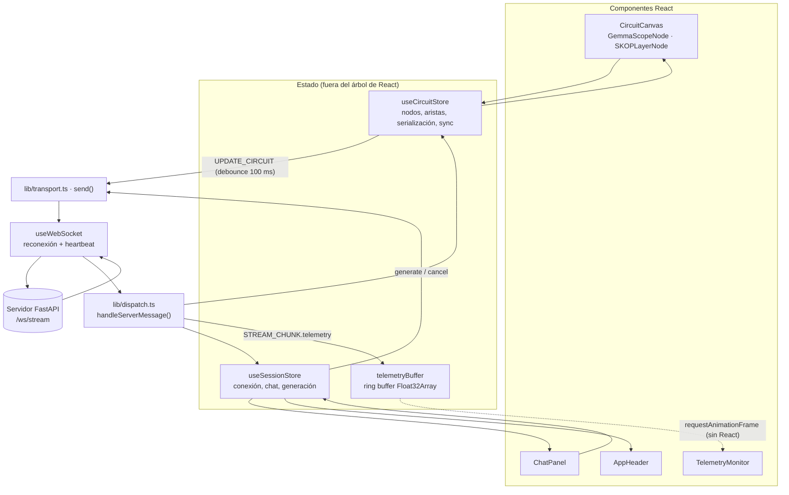
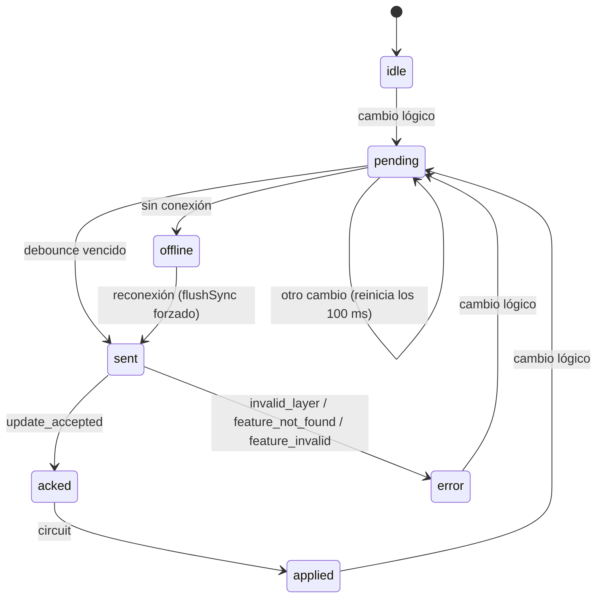

# BrainSteer · LatentFlow — cabina visual

Cliente web de [`latentflow/api/server.py`](../latentflow/api/server.py): un
**canvas de circuitos** (React Flow) donde se componen features de Gemma Scope e
inyectores de capa SKOP, un **chat en streaming** y un **osciloscopio de riesgo**
que dibuja token a token el cociente de Rayleigh de las cabezas de atención.

React 18 · TypeScript estricto · Zustand 5 · React Flow 11 · Tailwind CSS 4 · Vite 7 · Vitest 3 (+ jsdom y Testing Library para componentes).

```bash
npm ci
npm run dev        # http://127.0.0.1:5173 → ws://127.0.0.1:8000/ws/stream
npm test           # Vitest
npm run build      # tsc --noEmit (estricto) + vite build
```

Sin GPU, arranca el servidor con `latentflow-dev` (ver el [README raíz](../README.md)).

## Índice

- [Arquitectura](#arquitectura)
- [El canvas de circuitos](#el-canvas-de-circuitos)
- [`useCircuitStore`: estado y sincronización](#usecircuitstore-estado-y-sincronización)
- [Conexión WebSocket y chat](#conexión-websocket-y-chat)
- [`TelemetryMonitor`: osciloscopio en canvas](#telemetrymonitor-osciloscopio-en-canvas)
- [Estructura de ficheros](#estructura-de-ficheros)
- [Tests](#tests)

## Arquitectura

El flujo de datos es unidireccional. **Un único módulo toca el socket**
(`useWebSocket`): los stores sólo llaman a `send()` de `lib/transport.ts`, y todo
lo que llega pasa por `handleServerMessage()` de `lib/dispatch.ts`.



Los nombres del protocolo están centralizados en
[`src/lib/protocol.ts`](src/lib/protocol.ts): la UI habla de `UPDATE_CIRCUIT` y
`STREAM_CHUNK`, y esas constantes apuntan a los literales reales del cable
(`"update"` y `"token"`). Los tipos son un espejo del servidor; el contrato
completo está en el [README raíz](../README.md#contrato-del-websocket-wsstream).

## El canvas de circuitos

Un circuito es un DAG de dos tipos de nodo. Las aristas sólo van de una feature a
una capa (`isValidConnection` rechaza el resto y los duplicados).

**`GemmaScopeNode`** — una dirección de steering.
- **Feature ID** de Neuronpedia (`gemma-2-2b/20-gemmascope-res-16k/12082`), con
  enlace directo a su página. Vacío significa "usa el `r_q` calibrado por SKOP".
  Se edita en un borrador local: el ID llega al circuito (y al servidor) al pulsar
  **Enter** o al salir del campo, nunca a medio escribir; **Esc** lo descarta.
- **Slider de α** de −5 a 5 (paso 0.05), con relleno desde el cero; un doble clic
  en el valor lo devuelve a 0.
- **Estado de resolución**, leído del snapshot del servidor:

  | Rótulo | Significado |
  | --- | --- |
  | `↵ para aplicar` | Hay un borrador sin confirmar en el campo |
  | `W_dec ✓` | El servidor leyó el decoder de los pesos locales de Gemma Scope |
  | `simulada (dev)` | Backend de desarrollo: vector determinista derivado del ID |
  | `pendiente` | Conectada a una capa activa, esperando al servidor |
  | `r_q calibrado` | Sin Feature ID |
  | `error: att no soportado` (rojo) | SAE de atención: no se puede mapear a queries y se excluye |
  | `sin aplicar` | No está conectada a ninguna capa habilitada |

**`SKOPLayerNode`** — un inyector de capa.
- **Selector de capa** de 0 a L − 1, ajustado a la geometría que anuncia el
  servidor en `ready`.
- **Toggle** entre `[Additive Steering]` (`q' = q + α·r_q`) y
  `[Orthogonal Projection]` (`q' = q + α·P_ΔK·r_q` en las cabezas de riesgo).
- **Lecturas:** Σα de las features conectadas, cabezas de riesgo de la capa según
  el servidor, y si la capa está `aplicada` en el servidor.

El **inspector** bajo el canvas tiene tres pestañas: *Diagnóstico*, *Payload
UPDATE_CIRCUIT* (lo último que se enviará) y *DAG*, exportable a JSON.

### `serializeCircuit()`

[`src/lib/circuit.ts`](src/lib/circuit.ts) es una función pura: grafo → `{dag,
update, diagnostics, derived}`.

- **Capas activas:** una capa está activa si está habilitada y recibe al menos una
  feature habilitada.
- **Dirección de cada capa:** se envía como lista de `features`
  (`[{feature_id, alpha}]`) con ganancia `alpha: 1`; el servidor compone
  `Σ α_f · r_q(f)`.
- **Capas repetidas:** varios inyectores en la misma capa se fusionan. Con modos
  distintos gana `orthogonal`, la opción conservadora, y se avisa.
- **Diagnósticos:**
  - capas fuera de rango (error, se excluyen);
  - SAEs `att` (error, se excluyen);
  - features inyectadas fuera de su capa natural, la *L + 1* de un SAE de la capa *L* (aviso);
  - aristas inválidas;
  - circuito vacío (el steering se desactiva).
- **`derived`:** para cada nodo, si está activo y su α efectivo. Es lo que leen los
  nodos para encender su LED y sus lecturas.

## `useCircuitStore`: estado y sincronización

[`src/store/useCircuitStore.ts`](src/store/useCircuitStore.ts) es un store de
Zustand que guarda `nodes`, `edges`, la geometría del modelo (`numLayers`), el
último snapshot del servidor y el estado de sincronización.

### Serialización cacheada

`serializeCircuit()` produce objetos nuevos en cada llamada. Usarla como selector
haría que `useSyncExternalStore` detectara un snapshot distinto en cada render.
Por eso el store la **cachea** en `state.serialized` y sólo la recalcula cuando
cambia el circuito lógico (`commit()`). Los cambios cosméticos de React Flow
(`position`, `dimensions`, `select`: arrastrar o seleccionar nodos) actualizan el
grafo **sin** reserializar ni enviar nada al servidor.

### Debounce de 100 ms

Cada cambio lógico (slider, toggle, capa, Feature ID, conectar o borrar) llama a
`scheduleSync()`, que reprograma un **debounce trailing** de `SYNC_DEBOUNCE_MS =
100`:

```text
slider:  ▲ ▲ ▲ ▲ ▲ ▲ ▲ ▲ ▲ ▲ ▲ ▲ ▲ ▲ ▲ ▲ ▲ ▲ ▲ ▲      (un evento cada ~10 ms)
red:                                          ──100 ms──▶ UPDATE_CIRCUIT (valor final)
```

Un barrido del slider produce **un único** `UPDATE_CIRCUIT` con el valor final. Lo
verifican los tests con timers falsos y el e2e en Chromium (20–25 pulsaciones →
1 envío). Esto protege al servidor: cada actualización recalcula el ranking de
Rayleigh y, si incluye features nuevas, lee un SAE de disco.

`flushSync()` cierra el ciclo:

- **Deduplicación:** compara el payload con el último enviado (`lastSentKey`) y no
  reenvía uno idéntico, por ejemplo si el slider vuelve a su valor.
- **Antes de generar:** se llama justo antes de cada `generate`, así que el prompt
  sale siempre con el circuito actual.
- **Tras (re)conectar:** se fuerza (`flushSync(true)`). El circuito del servidor es
  global, así que el grafo local manda.

El estado de sincronización (`sync.state`) se muestra en la cabecera:



## Conexión WebSocket y chat

[`useWebSocket`](src/hooks/useWebSocket.ts) se monta una sola vez, en `App`:

- **URL:** `?ws=` en la URL de la página, si no `VITE_WS_URL` (ver `.env.example`)
  y, por defecto, `ws://127.0.0.1:8000/ws/stream`.
- **Reconexión:** backoff exponencial de 0.5 s a 8 s con jitter de ±20 %.
- **Heartbeat:** `ping` cada 10 s; la latencia aparece en la cabecera.
- **Cierre:** al cerrarse, retira el `send()` registrado y los stores pasan a
  `offline`. Es compatible con el doble montaje de `StrictMode`.

`dispatch.ts` enruta cada evento:

- `ready` fija la geometría y el tipo de SAE y fuerza el envío del circuito.
- `start` reinicia el buffer de telemetría.
- Cada `STREAM_CHUNK` del request activo se añade al mensaje del asistente y
  empuja su telemetría al buffer.
- `circuit` actualiza el snapshot que leen los nodos y, si se aplicó a mitad del
  stream, deja un marcador en el osciloscopio.

El chat (`ChatPanel`) se pega al final mientras el usuario no haya subido; Enter
envía y Shift+Enter hace salto de línea. El mismo botón genera o detiene, y cada
respuesta muestra tokens, tok/s y motivo de fin.

## `TelemetryMonitor`: osciloscopio en canvas

El osciloscopio dibuja, token a token, el cociente de Rayleigh
`R(q) = qᵀΣq / (‖q‖² + ε)` de cada cabeza de riesgo: la energía absoluta de SKOP,
sin cota superior fija. Si el servidor usa `normalize_rayleigh`, dibuja
`R̂(q) = qᵀΣ̂q / qᵀq` con `Σ̂ = Σ/tr(Σ)`, en [0, 1], y la cabecera lo indica. Está
diseñado para que **el streaming no provoque ningún render de React**.

**1. Los datos viven fuera de React.**
[`telemetryBuffer`](src/lib/telemetryBuffer.ts) es un singleton con anillos de
`Float32Array` de 256 muestras:

- una serie por cabeza de riesgo (`capa:cabeza`), además del máximo y la media
  globales y el índice de token;
- un hueco se guarda como `NaN` y la traza se corta ahí, sin interpolar;
- un contador `version` se incrementa en cada escritura.

`dispatch.ts` escribe en él directamente; no hay `setState` por token.

**2. Bucle `requestAnimationFrame` con comprobación de versión.** El componente
monta un bucle rAF una sola vez. En cada frame compara `buffer.version` con la
última dibujada y, si no hay datos nuevos ni cambios de opciones, no hace nada. A
60 fps y con decenas de tokens por segundo, redibuja como mucho una vez por token.

**3. Render en canvas 2D puro.**
[`drawScope()`](src/lib/scopeRenderer.ts) es una función sin estado, sin
librerías de gráficas:

- **Retícula:** 10 × 5 divisiones.
- **Eje Y:** autoescalado a un tope "redondo" de cualquier década (1, 2, 2.5, 4,
  5 o 7.5 × 10ⁿ); con `normalize_rayleigh`, también puede fijarse a [0, 1]. Las
  etiquetas usan unas tres cifras significativas.
- **Referencia sin steering:** en las cabezas con steering, una traza discontinua
  del mismo color con $R(q - \delta)$, la misma query sin el vector inyectado en su
  capa. El hueco entre las dos es lo que mueve el steering a esa cabeza. El umbral
  de riesgo τ no se dibuja: está en la escala de las direcciones de steering, no en
  la de las queries.
- **Marcadores de hot-swap:** en violeta.
- **Una traza por cabeza:**
  - azul: proyectada por SKOP;
  - rosa: steering aditivo;
  - gris: capa sin steering, dibujada debajo.
- **Envolvente del máximo:** con brillo de fósforo.
- **Media:** discontinua.
- **Lecturas:** las cuatro cabezas más altas.

Recorre los `Float32Array` sin crear objetos por punto.

**4. Nitidez y tamaño.** Un `ResizeObserver` ajusta el canvas al contenedor
multiplicando por `devicePixelRatio`, de modo que se ve nítido en pantallas HiDPI.

React sólo vuelve a renderizar el componente al cambiar sus opciones (autoescala,
media, referencia sin steering).

## Estructura de ficheros

| Ruta | Rol |
| --- | --- |
| `src/lib/protocol.ts` | Tipos del protocolo y nombres de mensajes (`UPDATE_CIRCUIT`, `STREAM_CHUNK`…) |
| `src/lib/circuit.ts` | `serializeCircuit()`, `parseGemmaScopeId()`, `featureSource()` |
| `src/lib/debounce.ts` | Debounce trailing con `flush()` / `cancel()` |
| `src/lib/transport.ts` | `send()`: único canal de salida hacia el socket |
| `src/lib/dispatch.ts` | `handleServerMessage()`: eventos → stores y telemetría |
| `src/lib/telemetryBuffer.ts` | Ring buffer de telemetría (fuera de React) |
| `src/lib/scopeRenderer.ts` | `drawScope()`: render del osciloscopio |
| `src/store/useCircuitStore.ts` | Circuito, serialización cacheada y sincronización |
| `src/store/useSessionStore.ts` | Conexión, chat, generación y SAE activo |
| `src/hooks/useWebSocket.ts` | Conexión persistente |
| `src/components/nodes/` | `GemmaScopeNode`, `SKOPLayerNode`, `NodeShell` |
| `src/components/` | `CircuitCanvas`, `ChatPanel`, `TelemetryMonitor`, `AppHeader` |

Los puertos de Vite son fijos (`strictPort`: 5173 en dev, 4173 en preview) porque
el servidor sólo acepta WebSockets desde esos orígenes. Si el puerto está ocupado,
Vite falla en vez de saltar a otro que el servidor rechazaría.

## Tests

| Fichero | Qué cubre |
| --- | --- |
| `src/lib/circuit.test.ts` | Serialización: payload exacto, composición de features, fusión de capas, rangos, SAEs `att`, capa natural |
| `src/store/useCircuitStore.test.ts` | Debounce con timers falsos (barrido → 1 envío), deduplicación, `flush`, offline/reconexión, *clamping* |
| `src/lib/telemetryBuffer.test.ts` | Anillo, huecos `NaN`, marcadores, `version`, escala del eje Y |
| `src/lib/dispatch.test.ts` | Parseo de eventos, `ready`, streaming al chat y a la telemetría, errores de circuito, `invalid_message` de `generate` y de `update` |
| `src/components/nodes/GemmaScopeNode.test.tsx` | Feature ID (jsdom + Testing Library): teclear no envía, Enter/blur aplican, Esc descarta |

El CI (`.github/workflows/ci.yml`) ejecuta `npm ci`, `npm test` y `npm run build`
en cada push a `main` y en cada pull request.
